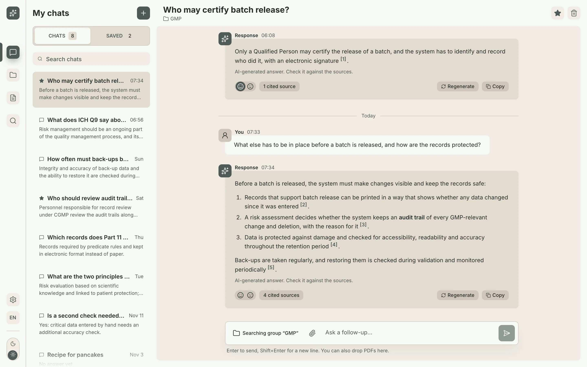
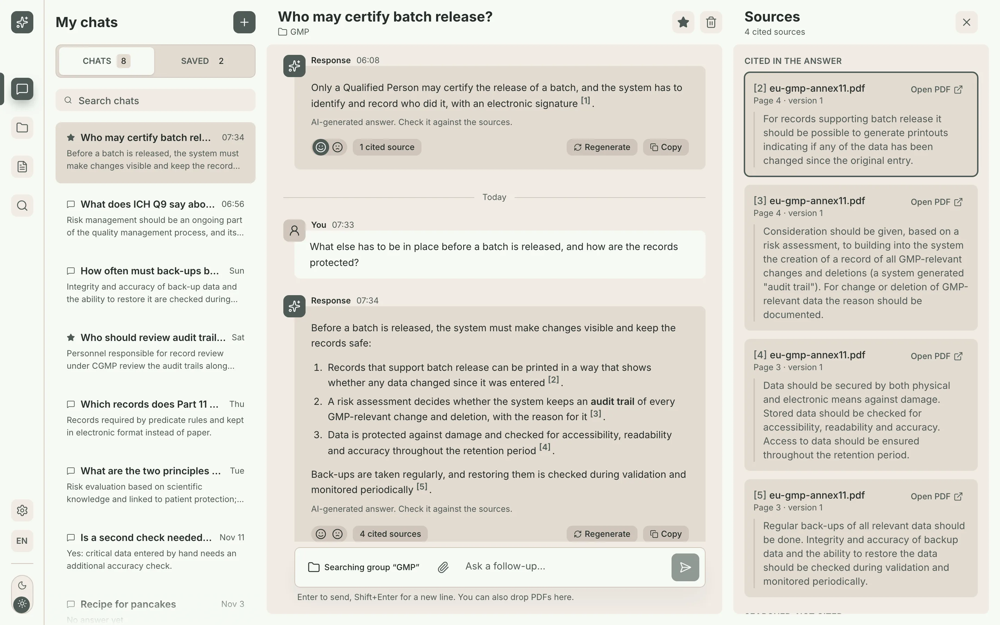
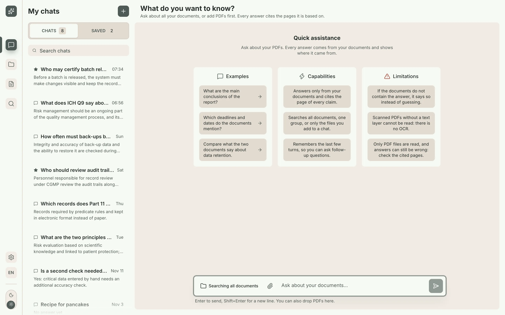
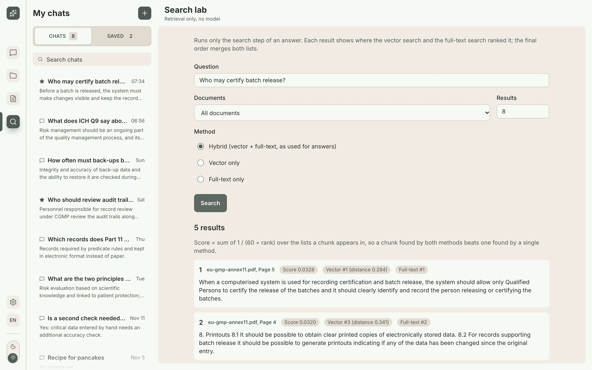
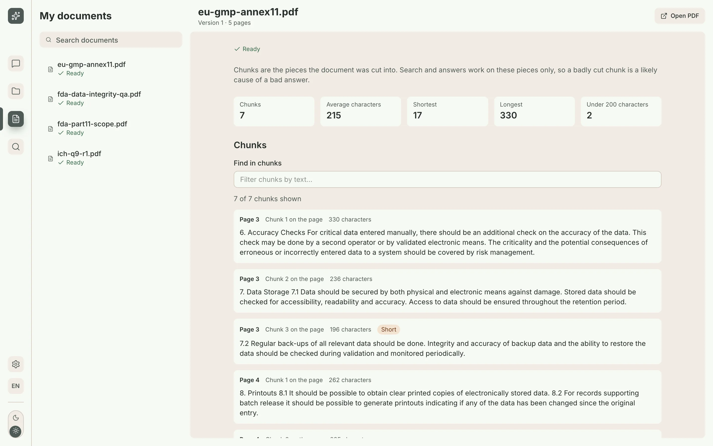
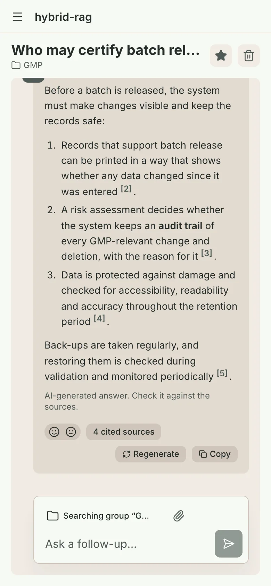
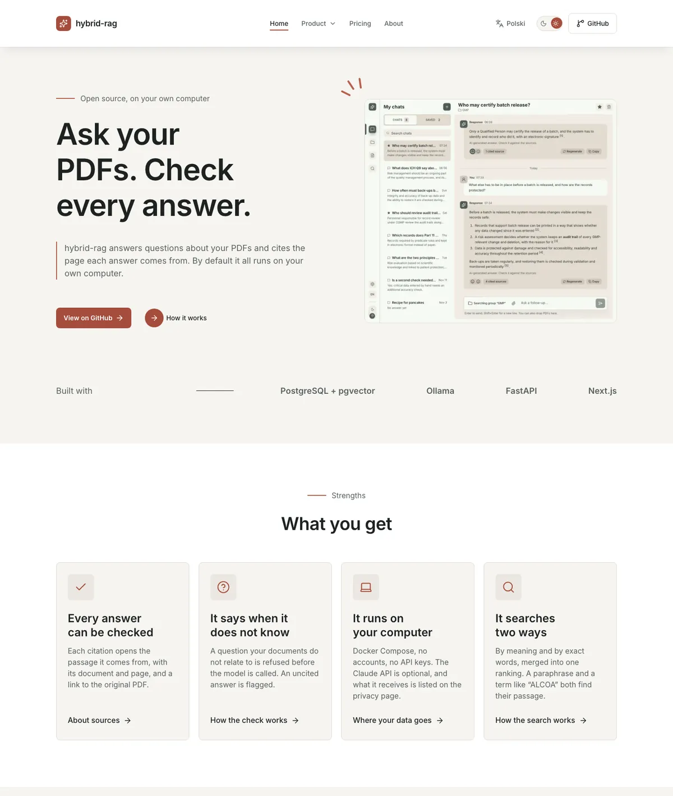
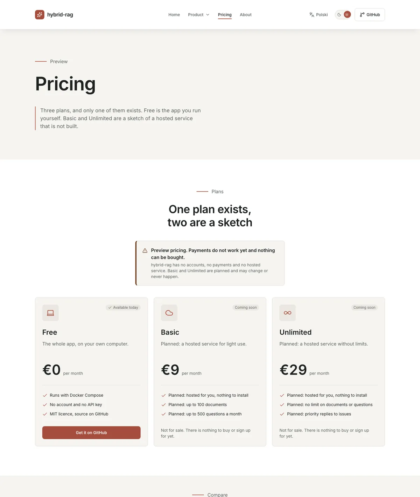
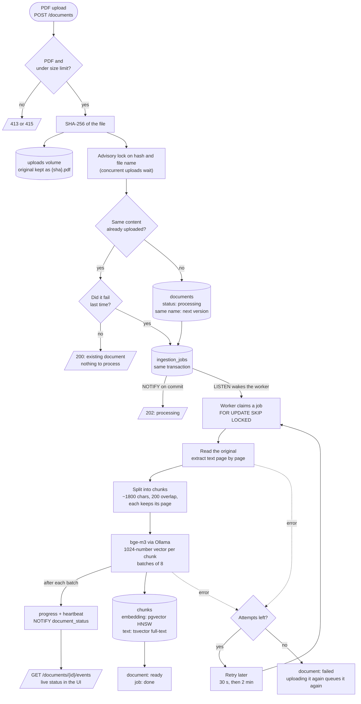
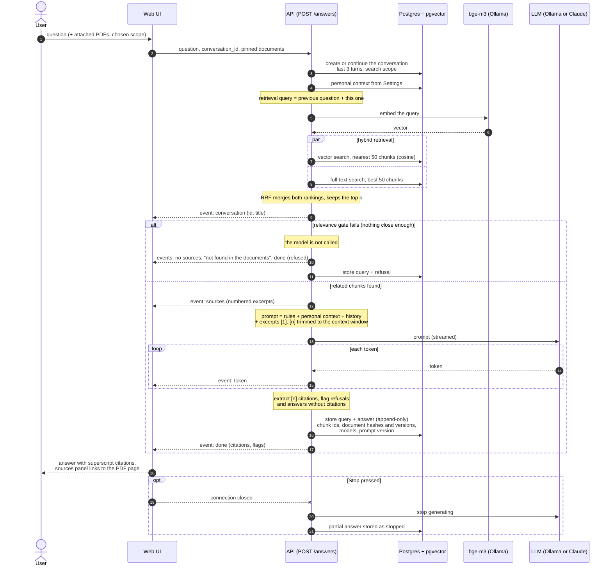

# hybrid-rag

Ask questions about your PDFs and get answers that cite the page they come from. Search combines
meaning (vector search with pgvector and bge-m3 embeddings) and exact words (full-text search),
merged with Reciprocal Rank Fusion. Every answer is stored with what it was based on: the exact
chunks, document versions, models and prompt version.

Everything runs on your own computer with Docker Compose. No accounts, API keys or hosting needed.

**Links:** [Website](https://hybrid-rag-rho.vercel.app/en) ·
[Figma design](https://www.figma.com/design/PMkNP9EogvXorM5SZ8XWLb/hybrid-rag) ·
[How it works (Polish)](docs/HOW_IT_WORKS.md) · [Evaluation](docs/EVALUATION.md)

> **Status:** the API and web UI work: upload with live indexing progress, groups, conversations
> with favourites, streamed answers with clickable citations, personal answer preferences and
> retrieval evaluation.

**Contents:** [Screenshots](#screenshots) · [Quick start](#quick-start) ·
[Runs on CPU](#runs-on-cpu) · [API](#api-at-a-glance) · [Web UI](#web-ui) ·
[How it works](#how-it-works) · [Retrieval quality](#retrieval-quality) ·
[Configuration](#configuration) · [Project layout](#project-layout) · [Website](#website) ·
[Design](#design) · [Monorepo](#monorepo) · [Limitations](#limitations) ·
[Development](#development)

## Screenshots

The app, with the public sample documents from `samples/` (light or dark, following your GitHub theme):

| | |
| --- | --- |
| <picture><source media="(prefers-color-scheme: dark)" srcset="apps/landing/public/screenshots/chat-dark.webp"></picture> | <picture><source media="(prefers-color-scheme: dark)" srcset="apps/landing/public/screenshots/sources-dark.webp"></picture> |
| Conversation: answers with clickable citations, rating, regenerate and copy | Sources: every cited passage with its document, page and a link to the PDF |
| <picture><source media="(prefers-color-scheme: dark)" srcset="apps/landing/public/screenshots/start-dark.webp"></picture> | <picture><source media="(prefers-color-scheme: dark)" srcset="apps/landing/public/screenshots/search-lab-dark.webp"></picture> |
| Start screen and the message box with the search scope | Search lab: retrieval only, with each method's rank |
| <picture><source media="(prefers-color-scheme: dark)" srcset="apps/landing/public/screenshots/document-dark.webp"></picture> | <picture><source media="(prefers-color-scheme: dark)" srcset="apps/landing/public/screenshots/mobile-chat-dark.webp"></picture> |
| Document page: the chunks and their statistics | On a phone |

The website (`apps/landing`, English and Polish):

| | |
| --- | --- |
| <picture><source media="(prefers-color-scheme: dark)" srcset="assets/readme/landing-home-dark.webp"></picture> | <picture><source media="(prefers-color-scheme: dark)" srcset="assets/readme/landing-pricing-dark.webp"></picture> |
| Home page | Pricing (a preview: the app has no payments) |

The pictures are made from demo data: `npm run screenshots` in `apps/web` (app) and in
`apps/landing` (website) regenerates them.

## Quick start

Requirements: Docker with Compose, about 4 GB of free disk space for the models and 8 GB of RAM.

```bash
docker compose up -d --build
```

The first start downloads two models through the `ollama-init` container (bge-m3 for
embeddings, about 1.2 GB, and qwen2.5:3b for answers, about 1.9 GB); the API starts once they
are in place. Follow progress with `docker compose logs -f ollama-init`. `GET /health` returns
200 when the database and models are ready and 503 otherwise.

All published ports are bound to `127.0.0.1`, so the database and Ollama are not reachable from
other machines.

Load the sample documents (four public regulatory PDFs kept in `samples/`, see
[samples/SOURCES.md](samples/SOURCES.md)):

```bash
./scripts/seed_samples.sh
```

On CPU the seed script waits up to 10 minutes for indexing to finish; set `WAIT_SECONDS` to change that.
If it times out, the documents keep processing in the background.

Then open the web UI at <http://localhost:3000>. The interactive API docs are at
<http://localhost:8000/docs>, or use curl:

```bash
# upload a PDF: 202 with status "processing"; a worker indexes it in the background
curl -F file=@my.pdf http://localhost:8000/documents

# follow its status and progress live (server-sent events), or poll GET /documents/{id}
curl -N http://localhost:8000/documents/<id>/events

# ask a question; the answer streams as server-sent events with [n] citations.
# The first event names the conversation; send its id back to ask a follow-up.
curl -N -X POST http://localhost:8000/answers \
  -H 'content-type: application/json' \
  -d '{"question": "Who is allowed to certify batch release?"}'
```

## Runs on CPU

The stack runs in Docker on the CPU only, so anyone can clone the repo and start it with one
command, without a GPU, drivers or a special Docker runtime.

The trade-off is speed. Embedding and text generation are noticeably slower than on a GPU:

- Indexing a PDF takes seconds to minutes depending on its size (a 29-page document took
  about 8 minutes on a laptop CPU).
- Answers start streaming after a short delay and arrive at CPU speed.
- The first request after startup is slower because the models are loaded into memory.

### Using the GPU

Docker Desktop on macOS cannot pass the GPU to a container, so for GPU speed (Metal on Apple
silicon, CUDA on Linux) run Ollama natively and let the containers call it. The
`docker-compose.native-ollama.yml` overlay does that: it leaves out the Ollama container and
points the API and worker at `host.docker.internal:11434`.

```bash
brew install --cask ollama          # or see https://ollama.com/download; then start it
ollama pull bge-m3 && ollama pull qwen2.5:3b
docker compose stop ollama          # if the container version was running (same port)
docker compose -f docker-compose.yml -f docker-compose.native-ollama.yml up -d
```

The models now live on the host, not in the `ollama` volume. The index stays valid because the
embedding model is the same. While an answer is written, `ollama ps` shows `100% GPU`. With a
GPU a larger chat model is practical (`LLM_MODEL=qwen2.5:7b`). Alternatively use the Claude API
for generation (`LLM_PROVIDER=anthropic`); nothing else changes.

## API at a glance

| Area | Endpoints |
| --- | --- |
| Documents | `POST /documents` (optional `group_id`), `GET /documents`, `GET /documents/{id}`, `GET /documents/{id}/events` (status SSE), `GET /documents/{id}/chunks` (how it was cut), `GET /documents/{id}/file` (original PDF), `DELETE /documents/{id}` |
| Groups | `GET/POST /groups`, `GET/PATCH/DELETE /groups/{id}`, `PUT/DELETE /groups/{id}/documents/{document_id}` |
| Conversations | `GET /conversations` (`group_id`, `favorites`), `GET/PATCH/DELETE /conversations/{id}`, `PUT /conversations/{id}/documents` (search scope) |
| Answers | `POST /answers` (SSE; closing the connection stops generation) |
| Settings | `GET/PUT /settings` (personal context: how answers should be written) |
| Search, health | `POST /search`, `GET /health`, `GET /health/live` |

Full schemas, including the server-sent event types, are in the OpenAPI document at `/openapi.json`.

**Search scope.** A conversation with pinned documents searches only those; otherwise it
searches its group's documents, or all documents when it has no group. Files attached to a
message are pinned to its conversation (`pin_document_ids` on `POST /answers`), and
`PUT /conversations/{id}/documents` changes the selection (an empty list returns to the default).

**Groups** collect documents and conversations (for example "med" or "legal"). A conversation in a
group searches only that group's documents; a document can belong to several groups and is
indexed once. Deleting a group deletes its conversations; `GET /groups/{id}` returns
`conversation_count` so a client can warn first. Up to 10 conversations can be favourites
(enforced in the database). Nothing is ever deleted from the database: documents, groups and
conversations are hidden (soft delete), and questions and answers are never changed.

## Web UI

An icon rail switches the column next to it between conversations (with a Chats / Saved tab for
the up to 10 favourites, a title filter and a preview of each latest answer), groups and
documents with their indexing status; the centre holds the conversation and a message box that
also takes PDFs (button or drag and drop). The rail also holds the search lab, settings,
language and the light/dark switch.

- Files are uploaded as soon as they are added and show live indexing progress; sending waits
  until they are indexed. In a group, new files are added to that group.
- A chip next to the message box always says what the next answer will search ("Searching all
  documents", "Searching group “med”", "Searching 2 selected documents"). Attached files are
  pinned to the conversation; the chip opens a picker to choose documents or clear the selection.
- Answers stream in. Citation numbers open a sources panel with the excerpt and a link to the
  original PDF at the cited page. **Stop** ends generation; the partial answer is kept.
- Answers are labelled as AI-generated, and flagged when nothing was found or nothing is cited.
  The model's Markdown (lists, bold, code) is rendered as such, never as HTML. A refusal is shown
  in the language of the interface. Each answer can be rated, copied without its citation
  markers, or asked again; turns of different days are separated by the day.
- Answers are written in the language of the question: a Polish question is answered in Polish
  even when the documents are in English.
- A group page lists its conversations (favourite, delete) and documents. Deleting a group asks
  for confirmation and says how many conversations will be deleted with it.
- English and Polish. The browser language decides (English when it is neither); Settings can
  override it. English is the source of truth: a key missing in Polish fails the type check and
  the unit tests, which also check placeholders and Polish plural forms.
- **Document page** (click a document in the sidebar): the chunks the PDF was cut into, with page,
  length and a text filter, plus size statistics and a flag on very short chunks. Bad answers
  usually start with a bad cut, so this is where to look first.
- **Search lab** (rail, magnifier icon): runs only the retrieval step, with no model. For a question it
  shows each chunk's rank in the vector search and in the full-text search, the distance and the
  merged score, for hybrid, vector-only or full-text-only mode. An empty result explains that the
  relevance gate refused. Each hit links to its chunk on the document page.
- Light and dark theme. It follows the system unless Settings → Appearance says otherwise.
- Accessibility: WCAG 2.1 AA is checked with axe in the end-to-end tests (light and dark mode,
  dialogs, a 320 px wide phone). Keyboard navigation, skip link, focus management in dialogs
  and the mobile menu, screen-reader announcements when an answer finishes, reduced motion.

## How it works

### From upload to searchable chunks



### From question to cited answer



The numbered steps below describe the same flow in words.

1. **Upload.** The original PDF is kept unchanged on the `uploads` volume under its SHA-256
   (identical files are deduplicated) and an ingestion job is queued in the same transaction as
   the document row. The same file name with different content becomes a new version; older
   versions are kept.
2. **Ingestion (worker).** A separate `worker` service takes jobs from a queue table in Postgres
   (`FOR UPDATE SKIP LOCKED`, woken by `LISTEN/NOTIFY`). It splits the text into chunks of about
   1800 characters that remember their page, embeds them with bge-m3 and stores them. Failed
   attempts are retried with backoff (30 s, 2 min, then the document is marked failed), and a job
   whose worker died is taken over once its heartbeat is stale. Status and progress are published
   to `GET /documents/{id}/events`.
3. **Retrieval.** The question is embedded. Vector search and full-text search each return 50
   candidates and RRF merges the rankings. Search can be limited to chosen documents.
4. **Relevance gate.** Nearest neighbours always exist, so "some results" proves nothing. The
   question counts as related to the corpus when the nearest chunk is within a cosine distance
   threshold (0.5 for bge-m3, calibrated on held-out questions) or, in hybrid mode, when one
   chunk contains every content word of the question (this keeps exact terms such as "ALCOA").
   Otherwise the API refuses without calling the model.
5. **Answering.** The top chunks go into the prompt as numbered, delimited excerpts, trimmed to
   fit the model's context window. In a conversation the model also sees the last three turns,
   and a follow-up is searched together with the previous question. The model must cite them as `[n]` and is told that excerpt
   text is data, not instructions. Refusals and answers without citations are flagged.
6. **Records.** Each answer is stored with the chunk ids, document hashes and versions, the
   embedding and LLM models, the prompt version and the personal context it was written with.

More detail: [docs/HOW_IT_WORKS.md](docs/HOW_IT_WORKS.md) (in Polish).

## Retrieval quality

On 34 answerable questions over four public regulatory documents, hybrid search reaches hit@10 of 100%
versus 91% for vector search alone, and it is the only mode that handles both exact terms and
Polish questions over English documents. It returned nothing for all 10 off-topic questions. Method, numbers and limitations are in
[docs/EVALUATION.md](docs/EVALUATION.md). Reproduce with:

```bash
docker compose exec api python -m app.evaluation --misses
```

## Configuration

Copy `.env.example` to `.env` to change defaults.

| Variable | Default | Meaning |
| --- | --- | --- |
| `LLM_PROVIDER` | `ollama` | `ollama` (local) or `anthropic` |
| `LLM_MODEL` | `qwen2.5:3b` | Model for the chosen provider |
| `ANTHROPIC_API_KEY` | empty | Required only for `anthropic` |
| `EMBED_MODEL` | `bge-m3` | Embedding model. The schema stores 1024-dimension vectors, so another model needs the same dimension (or a migration), a full re-index and a new `MAX_VECTOR_DISTANCE` |
| `MAX_VECTOR_DISTANCE` | `0.5` | Relevance gate threshold (cosine distance); `off` disables it |
| `LLM_NUM_CTX` | `8192` | Context window used for the model and for trimming the prompt |
| `OLLAMA_URL` | `http://ollama:11434` | Use `http://host.docker.internal:11434` for a native Ollama |
| `LLM_MAX_TOKENS` | `768` | Cap on answer length |
| `MAX_UPLOAD_MB` | `50` | Upload size limit |
| `CORS_ORIGINS` | `http://localhost:3000` | Comma-separated browser origins allowed to call the API |
| `DB_PORT` | `5433` | Host port of Postgres |
| `PUBLIC_API_URL` | `http://localhost:8000` | API address as seen by the browser, baked into the web UI at build time |
| `INGEST_MAX_ATTEMPTS` | `3` | Attempts per document before it is marked failed |
| `INGEST_STALE_SECONDS` | `600` | A running job without a heartbeat this long is taken over |

## Project layout

```
apps/api/app/
  api/routes/     HTTP controllers
  schemas/        Pydantic request/response and event models
  services/       business logic and transactions
  repositories/   all SQL
  rag/            chunking, rank fusion, PDF, embedder, LLM providers
  core/           config, database, domain errors, migrations
  storage/        original file storage (content-addressed, verified on read)
  worker/         ingestion worker (`python -m app.worker`)
apps/api/migrations/         SQL migrations applied at startup
apps/web/                    web UI (Next.js, React, Tailwind CSS, TanStack Query, Zustand)
  src/app/          routes only: / (new conversation), /c/[id] (conversation), /g/[id] (group)
  src/api/          HTTP client, types generated from OpenAPI, React Query hooks per domain
  src/features/     views by area (chat, composer, scope, groups, sidebar, settings, layout)
  src/stores/       Zustand: streaming answer, UI, notifications, language, theme
  src/i18n/         English (source of truth) and Polish texts, translator, language detection
  src/hooks/        shared hooks (asking a question, scrolling)
  tests/e2e/        Playwright + axe tests against a mocked API
packages/design-tokens/      colour palettes and theme variables, plain CSS
packages/ui/                 React components and icons, one component per file, and base styles
packages/eslint-config/      shared ESLint configs
packages/typescript-config/  shared tsconfig bases
eval/                        evaluation questions
samples/                     public PDFs used as sample data and evaluation corpus
scripts/                     sample seeding and re-download
docs/                        requirements, plan, explanation, evaluation
```

Requirements, including WCAG 2.1 and responsive design, are in
[docs/REQUIREMENTS.md](docs/REQUIREMENTS.md); the roadmap is in [docs/PLAN.md](docs/PLAN.md).

## Website

`apps/landing` is the project's website: Next.js, English and Polish (`/en`, `/pl`), with the
pages Home, Features, How it works, Pricing (a preview, the app has no payments), About, FAQ,
Privacy and Accessibility. It shares the components, tokens and translation code of the app
(`packages/*`) with its own palette, sets no cookies and makes no third-party requests, and is
checked with axe, HTML validation, a link checker and Lighthouse in CI. It is meant for Vercel;
setup, commands and the screenshot workflow are in [apps/landing/README.md](apps/landing/README.md).

## Design

The design of the app and the website is in Figma:
[hybrid-rag design file](https://www.figma.com/design/PMkNP9EogvXorM5SZ8XWLb/hybrid-rag).
It has three pages:

- **Design System**: colours, type, spacing, radius, shadows, the grid, icons and every component
  with its variants and states (buttons, form fields, tabs, dialogs, toasts and inline alerts, and
  the parts of the website and the app).
- **Landing**: Home, Features, How it works and FAQ, on desktop (1440 px) and phone (375 px).
- **App**: start, conversation with sources, group, document, search lab and settings.

Every screen exists in a light and a dark version. Colours, spacing and radius are Figma variables
and text uses text styles, all named after the code.

## Monorepo

The JavaScript side is an npm workspace (`apps/*` and `packages/*`), and
[Turborepo](https://turborepo.dev) runs lint, type check, tests and build in dependency order.
`apps/api` is Python with its own `pyproject.toml` and has no `package.json`, so npm ignores it.

Dependencies point one way: apps use `@hybrid-rag/ui` and `@hybrid-rag/i18n` (the translation
core; each app keeps its own catalogs), and `@hybrid-rag/ui` uses `@hybrid-rag/design-tokens`. Nothing in `packages/` imports from `apps/`. The tokens are a
separate package because they are plain CSS: another site can use the same colours and theme
without React or the components. Packages ship source (`.ts`, `.tsx`, `.css`) and have no build
step; the app compiles them.

A new Next.js app in `apps/` lists both packages as dependencies and adds
`transpilePackages: ["@hybrid-rag/ui"]` to its `next.config.ts`. Its global CSS starts with:

```css
@import "tailwindcss" source(none);
@import "@hybrid-rag/design-tokens";
@import "@hybrid-rag/ui/styles.css";
@source "../";
```

`source(none)` turns off Tailwind's automatic file scanning, so `@source` names the folder to
scan (relative to the CSS file). The UI package registers its own sources in `styles.css`.
Components are imported one by one, for example `@hybrid-rag/ui/button`.

## Limitations

- Scanned PDFs without a text layer are not supported (no OCR).
- Small local models can produce clumsy answers, especially in Polish, and sometimes reply with
  a citation only. The refusal sentence is in English.
- Uploaded documents go into the prompt. Delimiters and instructions reduce prompt injection
  from a malicious PDF but cannot rule it out; anyone can upload to the shared library.
- The relevance threshold is calibrated for bge-m3 on this corpus; other corpora may need a
  different value.
- The stopword list used for keyword search is English only.
- No authentication yet: documents, groups, conversations and favourites are shared by everyone
  who can reach the API.
- Follow-up questions are searched together with the previous question. This helps with short
  follow-ups ("how often?") but can pull in the old topic when the user changes subject.
- No database connection pool: every request, worker step, status stream and stored answer opens
  its own Postgres connection. That is fine for a single user, but under concurrent load the
  connection setup adds latency and can hit Postgres' `max_connections`. The fix is a shared
  `psycopg_pool.ConnectionPool` created at startup (in the FastAPI lifespan) and used by
  `get_conn` and the background services instead of `psycopg.connect`.
- Indexing and answering share one Ollama instance. On CPU, an answer waits while a document
  is being indexed (and the other way round), so the first answer after a large upload is slow.
- One worker processes one document at a time; on CPU more would only compete for the same
  cores. More workers can be started (`docker compose up --scale worker=2`) with a GPU.
- Each open status stream holds a database connection while it waits for changes.

## Development

Run with live code and auto-reload by adding the dev overlay:

```bash
docker compose -f docker-compose.yml -f docker-compose.dev.yml up -d
```

Dependencies are locked in `apps/api/uv.lock` (managed with [uv](https://docs.astral.sh/uv/)). Lint
and tests with exactly the locked versions, without installing anything locally:

```bash
docker run --rm -v "$PWD:/repo" -w /repo/apps/api -e UV_PROJECT_ENVIRONMENT=/tmp/venv \
  ghcr.io/astral-sh/uv:0.9.30-python3.12-bookworm-slim \
  sh -c "uv run --frozen ruff check . && uv run --frozen pytest -q"
```

Integration tests run against a real Postgres. They need a database whose name ends in `_test`
(the suite recreates its schema):

```bash
docker compose exec db createdb -U rag rag_test
docker run --rm --network hybrid-rag_default -v "$PWD:/repo" -w /repo/apps/api \
  -e UV_PROJECT_ENVIRONMENT=/tmp/venv -e TEST_DATABASE_URL=postgresql://rag:rag@db:5432/rag_test \
  ghcr.io/astral-sh/uv:0.9.30-python3.12-bookworm-slim uv run --frozen pytest -q
```

Schema changes go in a new file under `apps/api/migrations/`. Applied migrations are checksummed and
the API refuses to start if one of them was edited.

The API image is multi-stage, runs as a non-root user and has a liveness healthcheck
(`/health/live`). Base images and tools are pinned to exact versions.

Web UI (Node 22, version in `.nvmrc`). Server data lives in TanStack Query; shared client state
(the streaming answer, the mobile menu, notifications, language, theme) lives in Zustand, so each
token re-renders only the live answer. `npm run dev` serves it on <http://localhost:3000>
against the API on port 8000. After changing the API, regenerate the client types with
`npm run api:types -w @hybrid-rag/web`. Run all commands from the repository root:

```bash
npm ci                              # once, installs every workspace
npm run dev                         # development server
npm run lint && npm run typecheck && npm test
npx --workspace @hybrid-rag/web playwright install chromium     # once
npm run test:e2e                    # end-to-end + accessibility tests, mocked API
```

The web image is built from the repository root
(`docker build -f apps/web/Dockerfile .`), which is what `docker compose` does. It uses
`turbo prune` to build only the web app and the packages it needs.

CI runs lint, unit, integration and end-to-end tests (with axe accessibility checks), Docker
and compose checks, CodeQL, dependency review and secret scanning. A pull request runs only the
jobs for the parts it changes (API, web, Docker); pushes to `main` run all of them.

## License

See [LICENSE](LICENSE).
